<p align="center">
  
</p>

<h1 align="center">Click to Do for Linux</h1>

<p align="center">
  A personal Linux workbench with screen tools inspired by <b>Windows 11 Click to Do</b>. Tested on Niri and Umbriel; see <a href="docs/COMPATIBILITY.md">compatibility</a>.
</p>

<p align="center">
  
</p>


English | [Tiếng Việt](README.vi.md)

> Tested on one machine only (CachyOS, Niri with DMS and Umbriel, AMD Ryzen AI 9 HX 370 + RTX 5060). Other distros and compositors are implemented but unverified; see [docs/COMPATIBILITY.md](docs/COMPATIBILITY.md).

Click to Do is a personal Linux workbench for daily tasks, quick notes, Pomodoro focus sessions, and gentle water and movement reminders. Its screen tools add Vietnamese-aware OCR, QR detection, subject cutout, privacy redaction, color picking, and local AI. The resident daemon keeps timers and reminders running when the workspace window is closed.

## Contents

- [Features](#features)
- [Screenshots](#screenshots)
- [Install](#install)
- [Usage and shortcuts](#usage-and-shortcuts)
- [Vietnamese OCR and models](#vietnamese-ocr-and-models)
- [NPU and battery](#npu-and-battery)
- [CLI reference](#cli-reference)
- [Compatibility](#compatibility)
- [Contributing](#contributing)
- [License, contact, credits](#license-contact-credits)

## Features

- **One app shell:** Workbench and Settings share a window and sidebar. Configure Pomodoro, wellness reminders and work hours in Settings > Workday.
- **Light and dark modes:** switch from the sidebar or Settings > Appearance. The saved choice also themes the tray, screen toolbar and AI panel.
- **Personal workbench:** daily task list and notes saved locally; open it from the app launcher or system tray.
- **Pomodoro timer:** adjustable focus and break durations with short and long breaks; keeps running after the window closes.
- **Gentle wellbeing reminders:** configurable water and movement reminders, limited by default to weekdays from 09:00 to 18:00. Change the hours, mark a reminder done, snooze it, or pause reminders for an hour.
- **Work shortcuts:** open the screen OCR overlay or color picker directly from the workbench.
- **Fast screen freeze:** framebuffers stream from `grim` straight into RAM, with no temporary files.
- **HiDPI and multi-monitor:** physical pixels are mapped to logical Wayland coordinates (1.0x, 1.5x, 2.0x).
- **Text interaction:** click a line for actions (Copy, Translate, Explain, Ask AI, Search); double-click to copy and exit; `Shift + Click` to merge lines; `Ctrl + F` to find text on screen.
- **Images:** AI subject cutout (`u2netp` / `isnet`), background blur, privacy redact, built-in color picker with HEX loupe.
- **Bar integration:** system tray icon (StatusNotifierItem) and a JSON module for custom bars.
- **Local AI:** Ollama, or an OpenAI-compatible server such as FastFlowLM on the NPU.
- **Settings GUI:** compositor auto-detect with one-click shortcuts, model manager, diagnostics, uninstall.

## Screenshots

<table>
<tr>
<td width="50%"><b>Live OCR overlay</b> — every line is selectable, Vietnamese diacritics preserved<br>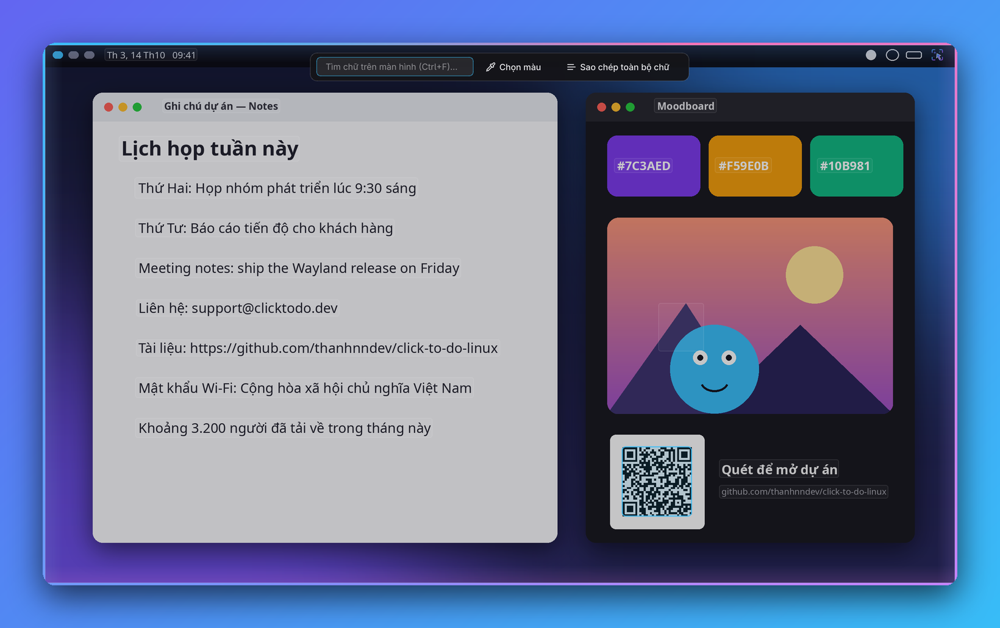</td>
<td width="50%"><b>Text actions</b> — Copy / Translate / Explain / Ask / Search<br>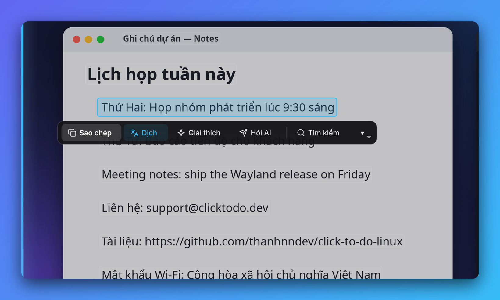</td>
</tr>
<tr>
<td><b>Smart entities</b> — URLs, e-mails<br>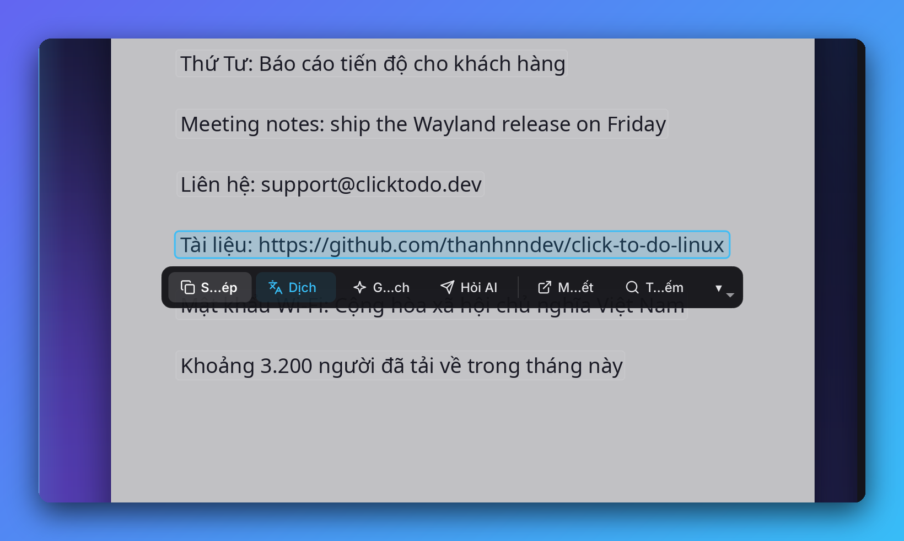</td>
<td><b>Multi-line select</b> with <code>Shift + Click</code><br>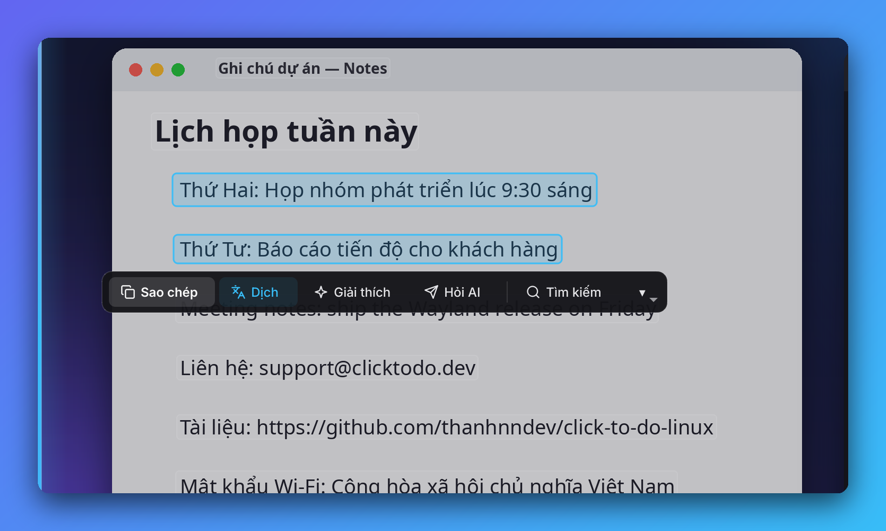</td>
</tr>
<tr>
<td><b>Image region</b> — Cutout, Blur BG, Redact, Save<br>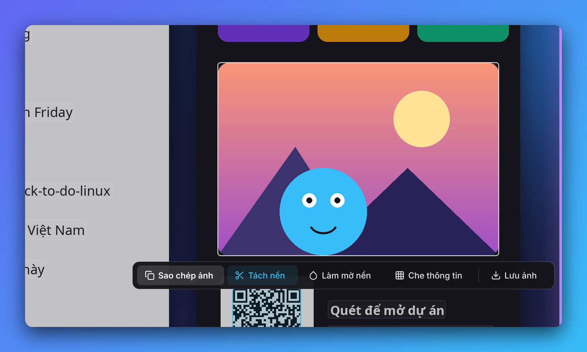</td>
<td><b>QR codes</b> detected automatically<br>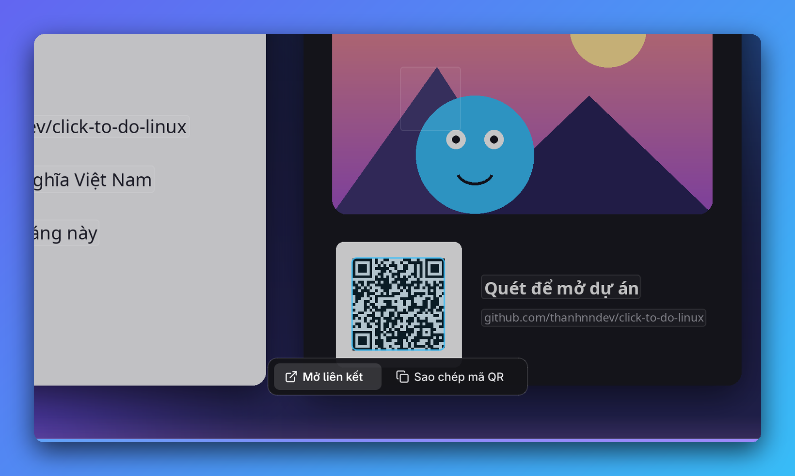</td>
</tr>
<tr>
<td><b>Region select</b> — Copy Image or Copy All Text in the region<br>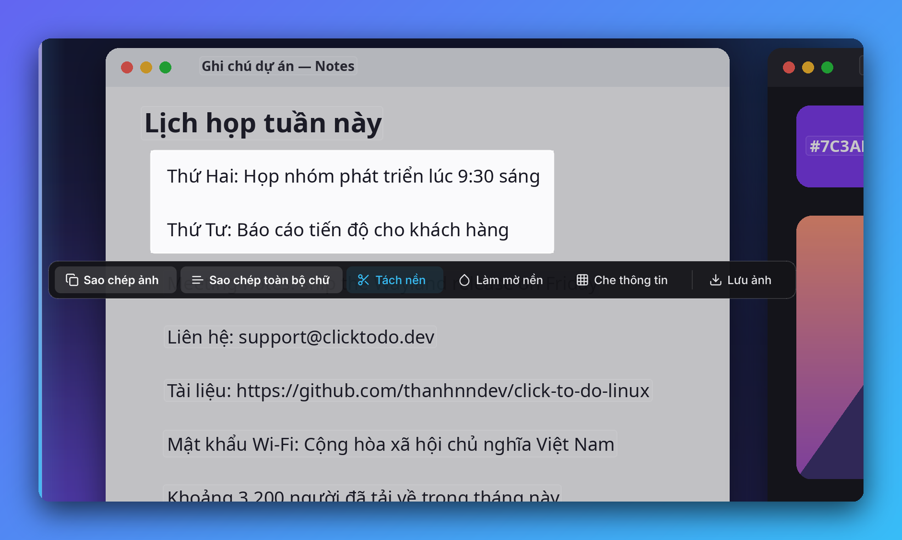</td>
<td><b>Live screen find</b> (<code>Ctrl + F</code>)<br>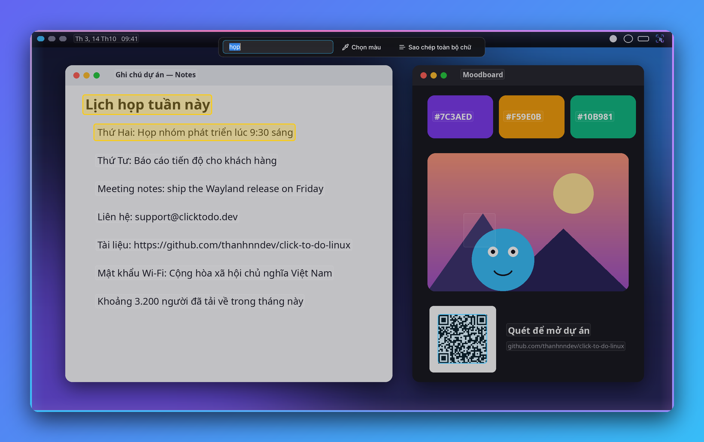</td>
</tr>
<tr>
<td><b>Color picker</b> with HEX loupe<br>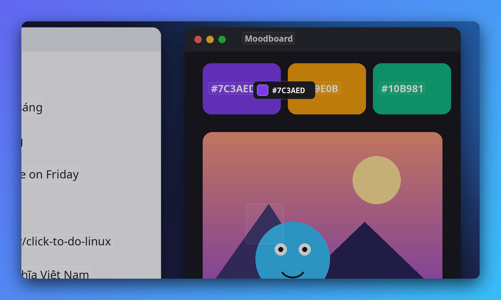</td>
<td><b>Local AI answers</b> via Ollama or NPU<br>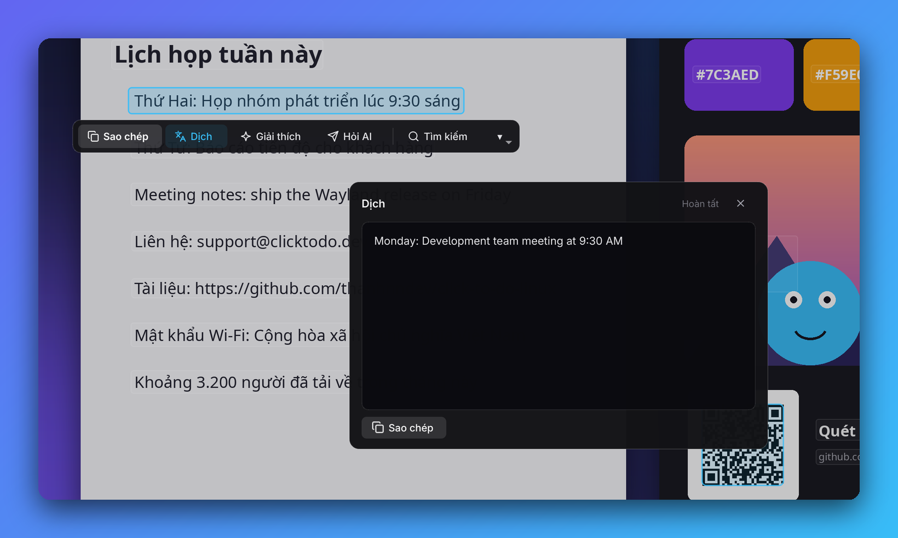</td>
</tr>
<tr>
<td><b>Bar / tray quick action</b> (Niri + DMS, Umbriel, Waybar, KDE)<br>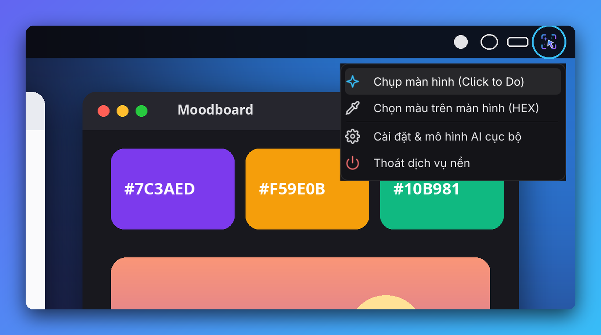</td>
<td></td>
</tr>
</table>

### Settings

| General & AI (Apply / Save and Close) | Shortcuts (compositor auto-detect) | System |
|---|---|---|
| 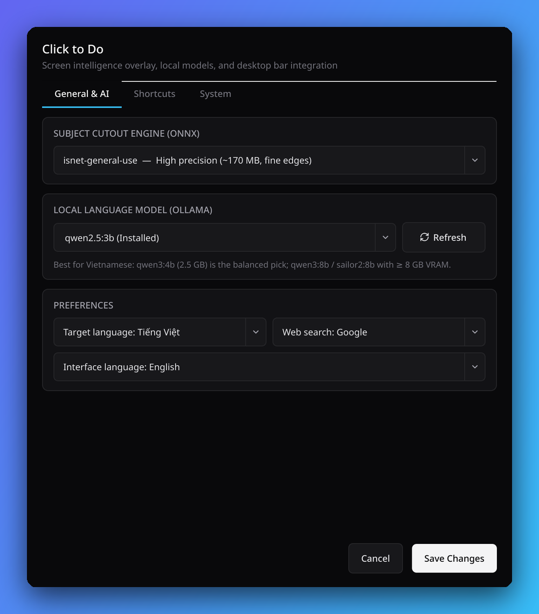 | 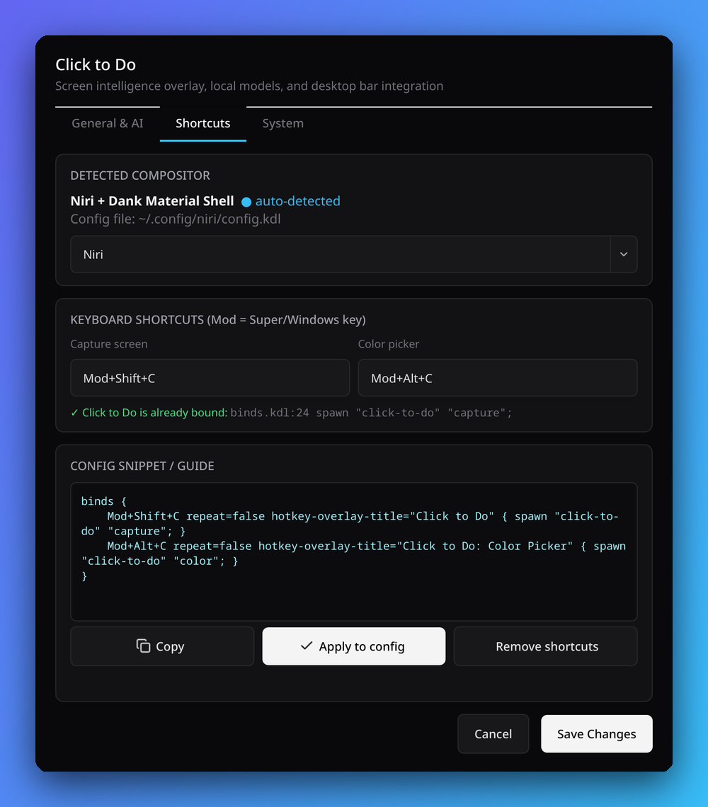 | 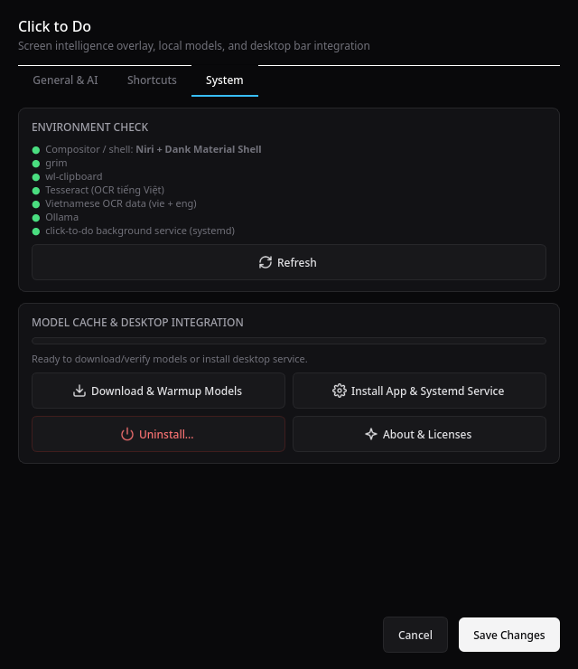 |

> Screenshots and the demo GIF are generated on a synthetic desktop by [`scripts/make_screenshots.py`](scripts/make_screenshots.py) — no private content.

## Install

```bash
git clone https://github.com/thanhnndev/click-to-do-linux.git
cd click-to-do-linux
./install.sh
```

Arch users can also build `packaging/arch` (AUR package `click-to-do-linux-git`, not yet published). Distro table, AUR, developer setup and uninstall: [docs/INSTALL.md](docs/INSTALL.md).

## Usage and shortcuts

Open **Click to Do** from your app launcher or run `click-to-do` to open the workbench. Screen capture and color picker shortcuts continue to work independently.

`click-to-do settings` > Shortcuts detects your compositor and can write the key bindings for you (defaults: `Mod+Shift+C` capture, `Mod+Alt+C` color picker). Per-compositor details and manual snippets: [docs/SHORTCUTS.md](docs/SHORTCUTS.md).

Reopening the overlay on identical screen content reuses OCR/QR boxes immediately. The daemon keeps up to six analyses in RAM for five minutes; changed pixels, display geometry, scale, or OCR settings trigger fresh analysis. Cached images and text are never written to disk, and quitting the daemon clears the cache. Changing clocks or video also invalidate the match.

## Vietnamese OCR and models

Stock PP-OCR drops Vietnamese tone marks, so detection (RapidOCR) is combined with Tesseract `vie+eng` per line. Install `tesseract` and use Settings > Download & Warmup Models. Local LLM recommendations and cutout models: [docs/MODELS.md](docs/MODELS.md).

## NPU and battery

The daemon is idle-cheap; the LLM is what wakes a discrete GPU. On AMD Ryzen AI laptops you can run the LLM on the NPU (FastFlowLM) and, optionally, text-line detection on the NPU (AMD Ryzen AI Software). Measurements, requirements and caveats are in [docs/NPU.md](docs/NPU.md). Both options appear in Settings only when an NPU is present, and the CPU path is always the fallback.

## CLI reference

| Command | Description |
| --- | --- |
| `click-to-do` / `click-to-do office` | Open the personal workbench |
| `click-to-do capture` | Freeze screen and open the overlay (via the resident daemon) |
| `click-to-do color` | Open the overlay in color picker mode |
| `click-to-do settings` | Open Settings and the model manager |
| `click-to-do daemon` | Start the resident daemon and bar icon |
| `click-to-do install` | Install XDG launchers, icons and session-aware background startup |
| `click-to-do uninstall [--purge]` | Remove them (optionally config and data) |
| `click-to-do bar-status` | JSON status for custom bar modules |
| `click-to-do stop` | Stop the daemon |

## Compatibility

Tested on a single machine; the full list of tested and untested distros, compositors and bars is in [docs/COMPATIBILITY.md](docs/COMPATIBILITY.md).

## Contributing

See [CONTRIBUTING.md](CONTRIBUTING.md). Compatibility reports from other setups are especially welcome.

## License, contact, credits

- License: [GPL-3.0-or-later](LICENSE) (required by the PyQt6 GPL dependency).
- Author: thanhnndev, [contact@thanhnn.dev](mailto:contact@thanhnn.dev), [Issues](https://github.com/thanhnndev/click-to-do-linux/issues).
- Built on RapidOCR / PaddleOCR, Tesseract, rembg, Ollama and PyQt6; see [CREDITS.md](CREDITS.md).

Not affiliated with Microsoft. "Click to Do" is a Windows 11 feature name used descriptively.
