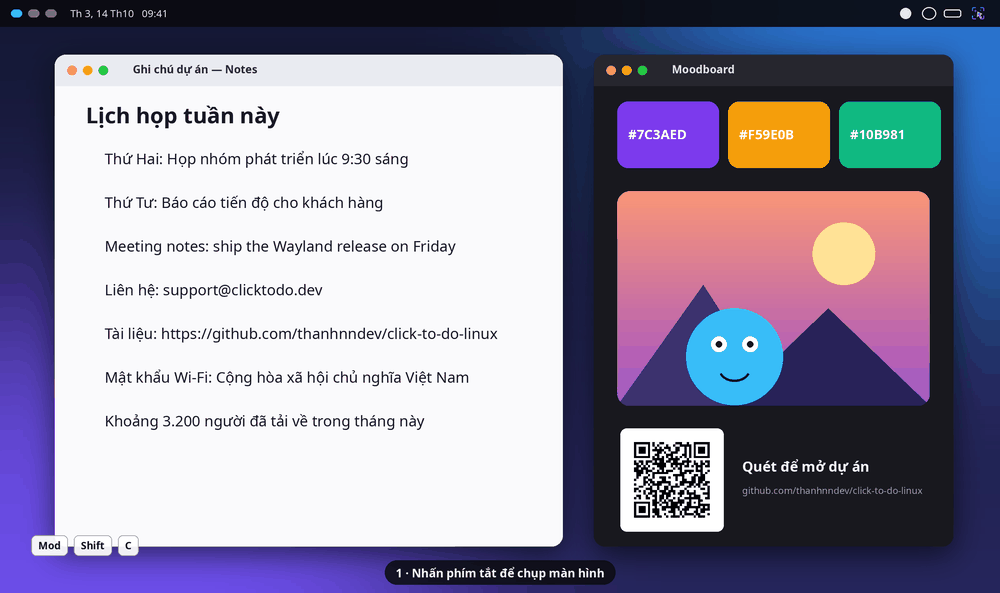

<p align="center">
  
</p>

<h1 align="center">Click to Do for Linux</h1>

<p align="center">
  A high-speed, native-feeling port of <b>Windows 11 Click to Do</b> built for modern Wayland compositors (<b>Niri</b>, <b>Umbriel</b>, <b>Hyprland</b>, <b>Sway</b>, <b>KDE Plasma</b>, <b>GNOME</b>).
</p>

<!-- Demo GIF / Video Showcase Placeholder -->
<p align="center">
  <a href="assets/demo.gif">
    
  </a>
  <br>
  <em>(Replace <code>assets/demo.gif</code> with your recorded walkthrough / showcase)</em>
</p>

Designed with a **Resident Daemon + Zero-Disk PPM Pipe** architecture to freeze the screen in **< 25ms**, detect text and QR codes in the background, isolate subjects (AI Cutout), redact sensitive areas, and run local Vietnamese/English LLMs via Ollama with diacritic-accurate Vietnamese OCR.

---

## Key Features

<p align="center">
  <!-- Feature showcase screenshot placeholder -->
  
</p>

- **Instant Screen Freeze (< 25ms):** Streams uncompressed framebuffers directly from `grim` into RAM (`QImage` / `PIL.Image`) with zero temporary disk writes and zero PNG encoding overhead.
- **HiDPI & Multi-Monitor Native:** Automatically maps physical framebuffer pixels to logical Wayland coordinates (1.0x, 1.5x, 2.0x fractional scaling) without offset or blurriness.
- **Zero-Scroll Overlay on Niri:** Uses stationary `(0, 0)` floating window rules so activating the overlay never shifts or scrolls Niri tiling columns.
- **Direct Point-and-Click Text Interaction:**
  - **Single-click** any text line to open the contextual action pill (`Copy`, `Translate`, `Explain`, `Ask AI`, `Search`).
  - **Double-click** any text line to immediately copy and exit in 0.5s.
  - **`Shift + Click`** multiple lines to merge non-contiguous text blocks.
  - **Live Screen Find (`Ctrl + F`):** Highlight matching text anywhere on screen in real time.
- **Image & Subject Intelligence (Drag Selection):**
  - **AI Subject Cutout (`u2netp` / `isnet`):** Removes background into a transparent PNG directly in your Wayland clipboard.
  - **Background Blur:** Isolates the subject and blurs the surrounding backdrop.
  - **Privacy Redact:** Pixelates sensitive regions (keys, emails, personal info) before copying.
  - **Built-in Eyedropper / Color Picker:** Middle-click anywhere (or click `Pick Color`) with a live HEX magnifier loupe.
- **Universal Bar Quick-Action Button:**
  - **System Tray (`StatusNotifierItem`):** Automatically embeds a sleek vector icon in **Dank Material Shell**, **Umbriel**, **Waybar**, **Quickshell**, **Hyprpanel**, or **KDE** (Left-click: Capture, Middle-click: Pick Color, Right-click: Menu).
  - **Custom Bar Module (`click-to-do bar-status`):** JSON output for custom bar widgets.

---

## Vietnamese OCR (Tiếng Việt)

Stock PP-OCR models (RapidOCR/PaddleOCR, even the Latin v5 one) silently **drop Vietnamese tone marks** (`Việt Nam` → `Vit Nam`). Click to Do therefore uses a hybrid pipeline:

1. **RapidOCR (ONNX)** locates every text line — fast, language-agnostic.
2. **Tesseract `vie+eng`** reads each line, keeping full diacritics (`Người đàn ông ấy đang ăn phở bò tái nạm`).

If `tesseract` is not installed the app falls back to RapidOCR (English/Chinese fine, Vietnamese loses diacritics).

```bash
# Arch / CachyOS            sudo pacman -S tesseract
# Debian / Ubuntu           sudo apt install tesseract-ocr
# Fedora                    sudo dnf install tesseract
```

The compact Vietnamese/English data files (~4.6 MB, `tessdata_fast`) are downloaded automatically to `~/.local/share/click-to-do/tessdata` by **Settings → Download & Warmup Models** — no system language packs required.

---

## Recommended Local Language Models (Ollama)

Sizes are Ollama default downloads (q4_K_M). "Vietnamese" is a qualitative rating from the published benchmarks and model cards we could find (VMLU, translation roundups) — no single benchmark covers all of these, so test on your own text.

| Model (`ollama pull …`) | Size | VRAM/RAM | Vietnamese | Best for | License |
| :--- | ---: | ---: | :---: | :--- | :--- |
| `qwen3:1.7b` | 1.4 GB | ~2 GB | ★★☆ | Old laptops, CPU-only, instant replies | Apache-2.0 |
| `sailor2:1b` | 1.1 GB | ~2 GB | ★★★ | Tiny model tuned for SE-Asian languages | Apache-2.0 |
| `qwen2.5:3b` | 1.9 GB | ~3 GB | ★★★ | Fast streaming, solid everyday default | Qwen Research |
| **`qwen3:4b`** | 2.5 GB | ~4 GB | ★★★★ | **Best balance** — translate / summarize / explain | Apache-2.0 |
| `gemma3:4b` | 3.4 GB | ~5 GB | ★★★★ | Natural phrasing, 128K context | Gemma Terms |
| `qwen3:8b` | 5.2 GB | ~7 GB | ★★★★★ | High accuracy, 8 GB GPUs | Apache-2.0 |
| `sailor2:8b` | 5.2 GB | ~7 GB | ★★★★★ | Strongest Vietnamese ≤ 8B (continued pre-training on 15 SEA languages) | Apache-2.0 |
| `aya-expanse:8b` | 5.1 GB | ~7 GB | ★★★★ | 23-language translation (**non-commercial** license) | CC-BY-NC |
| `gemma3:12b` | 8.2 GB | ~10 GB | ★★★★★ | Best quality on 12 GB GPUs | Gemma Terms |

> Qwen3 models have a "thinking" mode; Click to Do disables it (`think: false`) so output streams immediately.

Cutout models (ONNX, via `rembg`):

| Model | Size | Notes |
| :--- | ---: | :--- |
| `u2netp` | 4.7 MB | Instant subject isolation (< 50 ms) |
| `isnet-general-use` | 170 MB | High-precision edges |

---

## Installation & App Setup

### 1. One-command install (Arch, Debian/Ubuntu, Fedora, openSUSE)

```bash
git clone https://github.com/thanhnndev/click-to-do-linux.git
cd click-to-do-linux
./install.sh                  # system deps + app + launcher + systemd service
./install.sh --with-ollama    # ...and the Ollama runtime
./install.sh --no-deps --yes  # skip system packages, no prompts
```

`install.sh` detects your distro and installs `grim`, `wl-clipboard`, `tesseract` (+ Vietnamese data) with the native package manager, installs the app with [`uv tool install`](https://docs.astral.sh/uv/guides/tools/) on Python 3.12 (uv fetches it if needed), then runs `click-to-do install` to set up:

1. `~/.local/bin/click-to-do` launcher (managed by uv).
2. Desktop launcher (`~/.local/share/applications/click-to-do.desktop`) and icons.
3. **systemd user service** (`click-to-do.service`) so the daemon and bar icon start with your session.
4. The non-scrolling floating window rule in `~/.config/niri/config.kdl` (if Niri is present).

| Distro family | Packages installed |
| :--- | :--- |
| Arch / CachyOS / Manjaro | `grim wl-clipboard tesseract tesseract-data-vie tesseract-data-eng uv` |
| Debian / Ubuntu | `grim wl-clipboard tesseract-ocr tesseract-ocr-vie` + Qt runtime libs |
| Fedora / Nobara | `grim wl-clipboard tesseract tesseract-langpack-vie` + Qt runtime libs |
| openSUSE | `grim wl-clipboard tesseract-ocr tesseract-ocr-traineddata-vietnamese` |

#### Arch Linux — AUR / PKGBUILD

```bash
# from the AUR (once published)
yay -S click-to-do-linux-git        # or paru

# or build the PKGBUILD in this repo
cd packaging/arch && makepkg -si
```

The package depends on `python-pyqt6`, `python-opencv`, `python-onnxruntime`, `grim`, `wl-clipboard`, `tesseract` (+ `vie`/`eng` data) and the AUR packages `python-rapidocr` and `python-rembg`. It installs the launcher, icons and a systemd *user* unit system-wide; then:

```bash
systemctl --user enable --now click-to-do.service
click-to-do settings          # Shortcuts tab binds a key for your compositor
```

Developer setup from a checkout:

```bash
uv sync
uv run click-to-do install
```

### 2. Configure Models (GUI)

```bash
click-to-do settings

```

Select your preferred Cutout engine and Ollama model, then click **Download & Warmup Models**.
The UI language (Tiếng Việt / English / auto) can be changed in the same window.

### 3. Uninstall (Gỡ cài đặt)

From the GUI: **Settings → Uninstall…** (optionally tick *also delete config and downloaded data*).

From the terminal:

```bash
./install.sh --uninstall       # same as the two lines below + `uv tool uninstall`
click-to-do uninstall            # remove service, launchers, icons, Niri rule
click-to-do uninstall --purge    # ...and delete ~/.config/click-to-do + downloaded Tesseract data
```

Models pulled with Ollama are left untouched; remove them with `ollama rm <model>`. Finally, delete the project folder (and `~/.local/bin/click-to-do` is already removed if it was our symlink).

---

## Compositor & Keyboard Shortcuts

**Settings → Shortcuts** detects your compositor (and the shell/bar on top of it), shows a ready-to-use snippet, checks your existing config for key conflicts, and can write the shortcuts for you.
Defaults: `Mod+Shift+C` = capture, `Mod+Alt+C` = color picker (editable; `Mod` = Super).

| Compositor | Auto-detect | One-click apply | How it is applied |
| :--- | :---: | :---: | :--- |
| **Niri** | ✅ | ✅ | writes `~/.config/niri/click-to-do.kdl` + one `include optional=true` line, then `niri msg action load-config-file` |
| **Umbriel** | ✅ | ✅ | writes `~/.config/umbriel/click-to-do.toml` and adds it to `[include.optional]` |
| **Hyprland** | ✅ | ✅ | writes `~/.config/hypr/click-to-do.conf` + `source = …`, then `hyprctl reload` |
| **Sway** | ✅ | ✅ | writes `~/.config/sway/click-to-do.conf` + `include …`, then `swaymsg reload` |
| **River** | ✅ | ✅ | appends a managed block to `~/.config/river/init` |
| labwc / Wayfire | ✅ | guide | copy the generated XML / ini snippet |
| KDE Plasma / GNOME / COSMIC | ✅ | guide | step-by-step instructions (GNOME: one-shot `gsettings` script) |

Your own config files are never edited beyond a single include line (a `.click-to-do.bak` backup is made first). **Remove shortcuts** or `click-to-do uninstall` undoes it cleanly.

> ⚠ `Mod+Q` is "close window" on most Niri/Umbriel setups — don't use it. The Settings tab warns you about any key that is already taken.

Manual setup, if you prefer:

```kdl
// Niri
binds {
    Mod+Shift+C repeat=false { spawn "click-to-do" "capture"; }
    Mod+Alt+C   repeat=false { spawn "click-to-do" "color"; }
}
```

```toml
# Umbriel (keybinds.toml)
[keybinds]
"Mod+Shift+C" = { action = "spawn:click-to-do capture", repeat = false }
```

```ini
# Hyprland
bind = SUPER SHIFT, C, exec, click-to-do capture
```

```
# Sway
bindsym Mod4+Shift+c exec click-to-do capture
```

### Bar button — Umbriel / Noctalia / DMS / Waybar / Custom Bar Quick-Action Button

The background daemon **automatically displays a Quick-Action icon** in any bar supporting `StatusNotifierItem` (System Tray):

* **Left Click:** Trigger Click to Do Overlay
* **Middle Click:** Trigger Screen Color Picker (HEX)
* **Right Click:** Open Quick Menu (`Capture`, `Pick Color`, `Settings`, `Quit`)

If you also want a dedicated custom button module (e.g. in **Waybar** or **Umbriel**), use:

```json
"custom/click-to-do": {
    "exec": "click-to-do bar-status",
    "return-type": "json",
    "interval": "once",
    "on-click": "click-to-do capture",
    "on-click-middle": "click-to-do color",
    "on-click-right": "click-to-do settings"
}

```

---

## CLI Reference

| Command | Description |
| --- | --- |
| `click-to-do capture` | Freeze screen and open interactive overlay (< 25ms via daemon) |
| `click-to-do color` | Open overlay directly in HEX Color Picker loupe mode |
| `click-to-do settings` | Open minimalist Settings & Local Model Manager GUI |
| `click-to-do daemon` | Start background resident daemon and universal bar icon |
| `click-to-do install` | Install desktop app, icon, and systemd user service |
| `click-to-do uninstall [--purge]` | Remove desktop app, icon, service and Niri rule (optionally config/data) |
| `click-to-do bar-status` | Print JSON status for custom bar modules |
| `click-to-do stop` | Stop the running background daemon |

---

## License

Released under the **[GNU General Public License v3.0 or later](LICENSE)** (required by the PyQt6 GPL dependency).

## Credits

Built on RapidOCR / PaddleOCR, Tesseract, rembg (U²-Net, IS-Net), Ollama and PyQt6 — see [CREDITS.md](CREDITS.md) for the full list and licenses.

*Not affiliated with Microsoft. "Click to Do" is a Windows 11 feature name used descriptively.*
