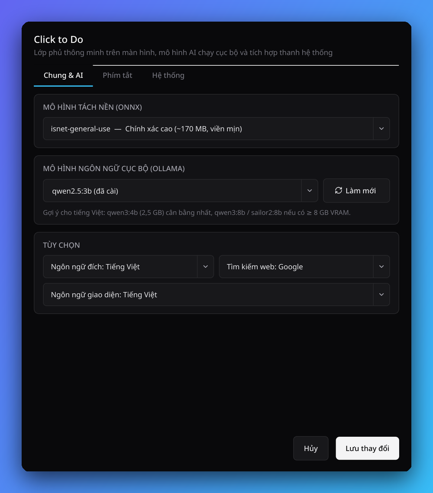

<p align="center">
  
</p>

<h1 align="center">Click to Do for Linux</h1>

<p align="center">
  Bàn làm việc cá nhân cho Linux, kết hợp công cụ màn hình lấy cảm hứng từ <b>Click to Do trên Windows 11</b>. Đã kiểm thử trên Niri và Umbriel; xem <a href="docs/COMPATIBILITY.md">danh sách tương thích</a>.
</p>

<p align="center">
  
</p>

[English](README.md) | Tiếng Việt

> Mới chỉ được kiểm thử trên một máy (CachyOS, Niri với DMS và Umbriel, AMD Ryzen AI 9 HX 370 + RTX 5060). Các distro và compositor khác đã được viết hỗ trợ nhưng chưa được xác minh; xem [docs/COMPATIBILITY.md](docs/COMPATIBILITY.md).

Không gian làm việc cá nhân cho Linux: quản lý việc trong ngày, ghi chú nhanh, Pomodoro và nhắc uống nước/vận động nhẹ. Khi cần xử lý nội dung trên màn hình, Click to Do còn có OCR tiếng Việt, nhận diện mã QR, tách chủ thể, che vùng nhạy cảm, lấy màu và AI chạy cục bộ. Daemon giữ bộ đếm và nhắc nhở hoạt động trong nền.

## Mục lục

- [Tính năng](#tính-năng)
- [Ảnh chụp màn hình](#ảnh-chụp-màn-hình)
- [Cài đặt](#cài-đặt)
- [Sử dụng và phím tắt](#sử-dụng-và-phím-tắt)
- [OCR tiếng Việt và model](#ocr-tiếng-việt-và-model)
- [NPU và pin](#npu-và-pin)
- [Lệnh CLI](#lệnh-cli)
- [Tương thích](#tương-thích)
- [Đóng góp](#đóng-góp)
- [Giấy phép, liên hệ, ghi công](#giấy-phép-liên-hệ-ghi-công)

## Tính năng

- **Một app chung:** Bàn làm việc và Cài đặt dùng chung cửa sổ với sidebar. Cấu hình Pomodoro, nhắc sức khỏe và giờ làm nằm trong Cài đặt > Ngày làm việc.
- **Giao diện sáng/tối:** đổi nhanh từ sidebar hoặc Cài đặt > Giao diện; lựa chọn được nhớ cho lần mở sau và áp dụng cho tray, thanh công cụ màn hình và bảng AI.
- **Bàn làm việc cá nhân:** danh sách việc và ghi chú theo ngày, tự lưu cục bộ; mở nhanh từ menu ứng dụng hoặc khay hệ thống.
- **Pomodoro:** phiên tập trung tùy chỉnh, nghỉ ngắn/nghỉ dài theo chu kỳ; bộ đếm tiếp tục chạy khi đóng cửa sổ.
- **Nhắc sức khỏe nhẹ nhàng:** nhắc uống nước và rời ghế vận động với khoảng thời gian tùy chỉnh; mặc định chỉ trong ngày thường, 09:00–18:00. Có thể đổi giờ, đánh dấu đã xong, hoãn 10 phút hoặc tạm dừng một giờ.
- **Lối tắt công việc:** mở OCR màn hình hoặc công cụ lấy màu ngay trong Bàn làm việc.
- **Đóng băng màn hình nhanh:** framebuffer từ `grim` được đưa thẳng vào RAM, không ghi file tạm.
- **HiDPI và nhiều màn hình:** ánh xạ pixel vật lý sang tọa độ logic của Wayland (1.0x, 1.5x, 2.0x).
- **Thao tác với văn bản:** bấm vào dòng để mở hành động (Sao chép, Dịch, Giải thích, Hỏi AI, Tìm kiếm); bấm đúp để sao chép rồi thoát; `Shift + Click` để gộp nhiều dòng; `Ctrl + F` để tìm chữ trên màn hình.
- **Hình ảnh:** tách chủ thể bằng AI (`u2netp` / `isnet`), làm mờ nền, che thông tin riêng tư, chấm màu có kính lúp HEX.
- **Tích hợp thanh bar:** biểu tượng khay hệ thống (StatusNotifierItem) và module JSON cho bar tùy chỉnh.
- **AI cục bộ:** Ollama, hoặc máy chủ tương thích OpenAI như FastFlowLM chạy trên NPU.
- **Giao diện Cài đặt:** tự nhận diện compositor và ghi phím tắt bằng một cú nhấp, quản lý model, chẩn đoán, gỡ cài đặt.

## Ảnh chụp màn hình

Xem bộ ảnh đầy đủ trong [README tiếng Anh](README.md#screenshots). Ảnh được tạo trên một màn hình giả lập bằng [`scripts/make_screenshots.py`](scripts/make_screenshots.py), không chứa nội dung riêng tư.

| OCR trực tiếp | Chọn vùng: Sao chép ảnh / toàn bộ chữ | Cài đặt (Áp dụng / Lưu và đóng) |
|---|---|---|
|  |  |  |

## Cài đặt

```bash
git clone https://github.com/thanhnndev/click-to-do-linux.git
cd click-to-do-linux
./install.sh
```

Người dùng Arch cũng có thể build `packaging/arch` (gói AUR `click-to-do-linux-git`, chưa đăng lên AUR). Bảng theo distro, AUR, cài cho nhà phát triển và gỡ cài đặt: [docs/INSTALL.md](docs/INSTALL.md).

Gỡ cài đặt: **Cài đặt > Gỡ cài đặt...** hoặc `click-to-do uninstall [--purge]`.

## Sử dụng và phím tắt

Mở **Click to Do** từ menu ứng dụng hoặc chạy `click-to-do` để vào Bàn làm việc. Các phím tắt chụp màn hình và lấy màu vẫn hoạt động độc lập.

`click-to-do settings` > tab Phím tắt tự nhận diện compositor và có thể ghi giúp bạn các phím (mặc định `Mod+Shift+C` chụp, `Mod+Alt+C` lấy màu). Chi tiết từng compositor và đoạn cấu hình thủ công: [docs/SHORTCUTS.md](docs/SHORTCUTS.md).

Mở lại overlay trên cùng nội dung màn hình sẽ dùng ngay box OCR/QR đã có. Daemon giữ tối đa 6 kết quả trong RAM trong 5 phút; ảnh, màn hình, tỉ lệ hiển thị hoặc cấu hình OCR thay đổi sẽ nhận diện lại. Cache không ghi ảnh hay chữ xuống đĩa và mất khi thoát daemon. Đồng hồ/video thay đổi cũng làm cache hết khớp.

## OCR tiếng Việt và model

PP-OCR gốc làm mất dấu thanh tiếng Việt, nên app dùng RapidOCR để tìm dòng chữ rồi dùng Tesseract `vie+eng` đọc từng dòng. Cài `tesseract` và dùng Cài đặt > Tải & khởi động model. Gợi ý LLM cục bộ và model tách nền: [docs/MODELS.md](docs/MODELS.md).

## NPU và pin

Daemon gần như không tốn tài nguyên khi rảnh; LLM mới là thứ đánh thức GPU rời. Trên laptop AMD Ryzen AI bạn có thể chạy LLM trên NPU (FastFlowLM) và tùy chọn chạy phát hiện dòng chữ OCR trên NPU (AMD Ryzen AI Software). Số đo, yêu cầu và lưu ý nằm trong [docs/NPU.md](docs/NPU.md). Cả hai tùy chọn chỉ hiện trong Cài đặt khi máy có NPU, và đường CPU luôn là phương án dự phòng.

## Lệnh CLI

| Lệnh | Mô tả |
| --- | --- |
| `click-to-do` / `click-to-do office` | Mở Bàn làm việc cá nhân |
| `click-to-do capture` | Đóng băng màn hình và mở overlay (qua daemon thường trực) |
| `click-to-do color` | Mở overlay ở chế độ lấy màu |
| `click-to-do settings` | Mở Cài đặt và trình quản lý model |
| `click-to-do daemon` | Chạy daemon thường trực và biểu tượng trên bar |
| `click-to-do install` | Cài launcher XDG, icon và tự khởi động daemon theo phiên desktop |
| `click-to-do uninstall [--purge]` | Gỡ các mục trên (tùy chọn xóa cả cấu hình và dữ liệu) |
| `click-to-do bar-status` | Trạng thái JSON cho module bar tùy chỉnh |
| `click-to-do stop` | Dừng daemon |

## Tương thích

Mới được kiểm thử trên một máy; danh sách đầy đủ các distro, compositor và bar đã/chưa kiểm thử nằm trong [docs/COMPATIBILITY.md](docs/COMPATIBILITY.md).

## Đóng góp

Xem [CONTRIBUTING.md](CONTRIBUTING.md). Rất hoan nghênh báo cáo tương thích từ các cấu hình khác.

## Giấy phép, liên hệ, ghi công

- Giấy phép: [GPL-3.0-or-later](LICENSE) (do phụ thuộc PyQt6 GPL yêu cầu).
- Tác giả: thanhnndev, [contact@thanhnn.dev](mailto:contact@thanhnn.dev), [Issues](https://github.com/thanhnndev/click-to-do-linux/issues).
- Xây dựng trên RapidOCR / PaddleOCR, Tesseract, rembg, Ollama và PyQt6; xem [CREDITS.md](CREDITS.md).

Không liên kết với Microsoft. "Click to Do" là tên một tính năng của Windows 11, được dùng để mô tả.
